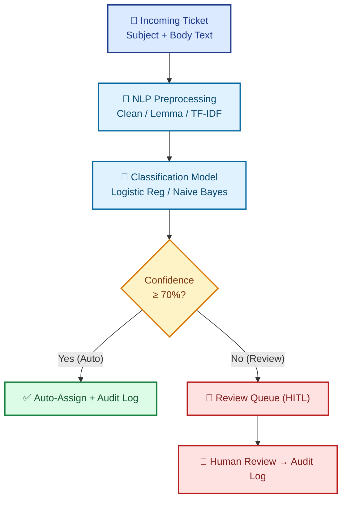

# 🎫 AI-Powered Support Ticket Classifier

### Human-in-the-Loop Review System — Implementation Specification

---

## 👥 Project Team & Resource Allocation

<table align="center">
  <tr>
    <td align="center" width="20%"><b>Aya Essam Mohamed El-Gammal</b></td>
    <td align="center" width="20%"><b>Taher Mostafa Ahmed El-Marenjoz</b></td>
    <td align="center" width="20%"><b>Alyaa Ahmed Selim Hassan</b></td>
    <td align="center" width="20%"><b>Mennat Allah Mahmoud Metwally</b></td>
    <td align="center" width="20%"><b>Yara El-Khatib Hassan Ali</b></td>
  </tr>
</table>

---

## 1️⃣ Executive Summary & Overview

Customer support operations in modern organizations face a persistent operational bottleneck: thousands of incoming support tickets must be manually read, categorized, and routed to the correct department. Industry estimates indicate that support teams waste **30–40%** of operational capacity on manual triage rather than resolving customer issues.

Current automated solutions fail by adopting rigid extremes: fully manual routing is slow and error-prone, while fully automated ML routing poses silent risks when handling ambiguous inputs.

> [!IMPORTANT]
> This project delivers an operational ML pipeline combining classical NLP (**TF-IDF + Logistic Regression**) with a **Human-in-the-Loop (HITL)** review mechanism for balanced efficiency and precision.

### Core System Workflow

<table align="center">
  <tr>
    <td align="center" width="25%"><h3>1</h3><b>Classifies</b> tickets automatically</td>
    <td align="center" width="25%"><h3>2</h3><b>Assigns</b> probability confidence scores</td>
    <td align="center" width="25%"><h3>3</h3><b>Escalates</b> low-confidence tickets (&lt;70%) to a Review Queue</td>
    <td align="center" width="25%"><h3>4</h3><b>Logs</b> all decisions in an Audit Log for feedback</td>
  </tr>
</table>

---

## 2️⃣ Project Problem & Core Capabilities

### 2.1 Key Operational Challenges

<table>
  <tr>
    <td width="50%">
      <h4>🐌 Manual Triage Bottleneck</h4>
      High ticket volume creates response delays.
    </td>
    <td width="50%">
      <h4>⚠️ Automation Risk</h4>
      Unverified models produce silent misclassifications.
    </td>
  </tr>
  <tr>
    <td width="50%">
      <h4>🔁 Missing Feedback Loop</h4>
      Manual corrections are rarely logged for retraining.
    </td>
    <td width="50%">
      <h4>🧑‍⚖️ Human Oversight Gap</h4>
      Autonomous AI lacks escalation mechanisms.
    </td>
  </tr>
</table>

### 2.2 Technical Solution Delivery

<table>
  <tr>
    <td width="50%">
      <h4>🧠 NLP Classification</h4>
      NLTK/spaCy text cleaning + TF-IDF representation.
    </td>
    <td width="50%">
      <h4>📊 Confidence Thresholds</h4>
      <code>predict_proba()</code> scoring with a 70% threshold.
    </td>
  </tr>
  <tr>
    <td width="50%">
      <h4>🖥️ Streamlit HITL Dashboard</h4>
      Real-time Review Queue for human validation.
    </td>
    <td width="50%">
      <h4>🧾 Traceable Audit Log</h4>
      SQLite/CSV record of reviewer actions &amp; timestamps.
    </td>
  </tr>
</table>

---

## 3️⃣ System Workflow Architecture

---

## 4️⃣ Project Planning & Management

### 4.1 Project Timeline (5-Week Sprint Roadmap)

<table>
  <tr>
    <th width="10%">Sprint</th>
    <th width="22%">Phase Name</th>
    <th>Key Operational Deliverables</th>
  </tr>
  <tr>
    <td align="center"><b>Week 1</b></td>
    <td><b>Data Prep &amp; Baseline</b></td>
    <td>Dataset collection, text preprocessing (NLTK/spaCy), TF-IDF vectorization, baseline model training.</td>
  </tr>
  <tr>
    <td align="center"><b>Week 2</b></td>
    <td><b>Model &amp; Confidence</b></td>
    <td>Model tuning, evaluation (Accuracy, F1-score), implementing <code>predict_proba()</code> confidence extraction.</td>
  </tr>
  <tr>
    <td align="center"><b>Week 3</b></td>
    <td><b>HITL &amp; Audit Database</b></td>
    <td>Setting routing threshold (70%), building Review Queue logic, designing SQLite/CSV Audit Log.</td>
  </tr>
  <tr>
    <td align="center"><b>Week 4</b></td>
    <td><b>Dashboard &amp; Integration</b></td>
    <td>Developing Streamlit dashboard (Auto-classification + Review Queue), experiment tracking with MLflow.</td>
  </tr>
  <tr>
    <td align="center"><b>Week 5</b></td>
    <td><b>Testing &amp; Delivery</b></td>
    <td>End-to-end integration testing, error analysis, final report writing, live demo &amp; presentation preparation.</td>
  </tr>
</table>

### 4.2 Team Roles & Responsibilities

<table>
  <tr>
    <th width="14%">Team Member</th>
    <th width="22%">Assigned Role</th>
    <th>Core Responsibilities</th>
  </tr>
  <tr>
    <td align="center"><b>Member 1</b></td>
    <td>🧹 <b>NLP &amp; Data Engineer</b></td>
    <td>Dataset acquisition, text preprocessing (NLTK/spaCy), TF-IDF vectorization, data quality assurance.</td>
  </tr>
  <tr>
    <td align="center"><b>Member 2</b></td>
    <td>🤖 <b>Machine Learning Engineer</b></td>
    <td>Model training, hyperparameter tuning, class imbalance handling, evaluation report generation.</td>
  </tr>
  <tr>
    <td align="center"><b>Member 3</b></td>
    <td>⚙️ <b>Backend &amp; Integration</b></td>
    <td>Confidence scoring logic, threshold routing implementation, Audit Log database architecture.</td>
  </tr>
  <tr>
    <td align="center"><b>Member 4</b></td>
    <td>🎨 <b>Frontend Developer</b></td>
    <td>Streamlit dashboard UI development (Auto-classification view + Review Queue interface).</td>
  </tr>
  <tr>
    <td align="center"><b>Member 5</b></td>
    <td>📦 <b>MLOps &amp; Doc Lead</b></td>
    <td>MLflow experiment tracking setup, code documentation, final report writing, live presentation lead.</td>
  </tr>
</table>

### 4.3 Risks & Mitigation Strategies

<table>
  <tr>
    <th width="22%">Identified Risk</th>
    <th width="12%">Prob.</th>
    <th width="12%">Impact</th>
    <th>Mitigation Strategy</th>
  </tr>
  <tr>
    <td><b>Time Constraint (5 Wks)</b></td>
    <td align="center"></td>
    <td align="center"></td>
    <td>Adhere strictly to MVP scope; utilize Streamlit for rapid UI development without custom JavaScript.</td>
  </tr>
  <tr>
    <td><b>Dataset Class Imbalance</b></td>
    <td align="center"></td>
    <td align="center"></td>
    <td>Apply class weights in loss function, or use resampling techniques (SMOTE) during model training.</td>
  </tr>
  <tr>
    <td><b>Threshold Tuning Issue</b></td>
    <td align="center"></td>
    <td align="center"></td>
    <td>Experiment with confidence thresholds (60%, 70%, 80%) to optimize auto-classification rate vs accuracy.</td>
  </tr>
  <tr>
    <td><b>Team Unavailability</b></td>
    <td align="center"></td>
    <td align="center"></td>
    <td>Cross-training team members for shared ownership of core pipeline modules.</td>
  </tr>
</table>

### 4.4 Key Performance Indicators (KPIs)

---

## 5️⃣ References

1. Pedregosa, F., et al. (2011). *Scikit-learn: Machine Learning in Python.* Journal of Machine Learning Research, 12, 2825–2830. https://scikit-learn.org
2. Loria, S. (2024). *TextBlob: Simplified Text Processing.* Available at: https://textblob.readthedocs.io
3. Rehurek, R., & Sojka, P. (2010). *Software Framework for Topic Modelling with Large Corpora.* Proceedings of the LREC 2010 Workshop. https://radimrehurek.com/gensim
4. Zaharia, M., et al. (2018). *Accelerating the Machine Learning Lifecycle with MLflow.* IEEE Data Engineering Bulletin, 41(4), 39–45. https://mlflow.org
5. Streamlit Inc. (2024). *Streamlit: The fastest way to build data apps.* Available at: https://streamlit.io

---

Project Planning & Management Document — 2026

