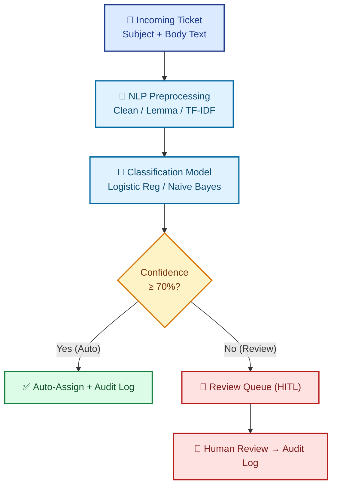

# 🎫 AI-Powered Support Ticket Classifier

### Human-in-the-Loop Review System — Implementation Specification

---

## 1️⃣ Executive Summary & Overview

Customer support operations in modern organizations face a persistent operational bottleneck: thousands of incoming support tickets must be manually read, categorized, and routed to the correct department. Industry estimates indicate that support teams waste **30–40%** of operational capacity on manual triage rather than resolving customer issues.

Current automated solutions fail by adopting rigid extremes: fully manual routing is slow and error-prone, while fully automated ML routing poses silent risks when handling ambiguous inputs.

> [!IMPORTANT]
> This project delivers an operational ML pipeline combining classical NLP (**TF-IDF + Logistic Regression**) with a **Human-in-the-Loop (HITL)** review mechanism for balanced efficiency and precision.

### Core System Workflow

<table align="center">
  <tr>
    <td align="center" width="25%"><h3>1</h3><b>Classifies</b> tickets automatically</td>
    <td align="center" width="25%"><h3>2</h3><b>Assigns</b> probability confidence scores</td>
    <td align="center" width="25%"><h3>3</h3><b>Escalates</b> low-confidence tickets (&lt;70%) to a Review Queue</td>
    <td align="center" width="25%"><h3>4</h3><b>Logs</b> all decisions in an Audit Log for feedback</td>
  </tr>
</table>

---

## 2️⃣ Project Problem & Core Capabilities

### 2.1 Key Operational Challenges

<table>
  <tr>
    <td width="50%">
      <h4>🐌 Manual Triage Bottleneck</h4>
      High ticket volume creates response delays.
    </td>
    <td width="50%">
      <h4>⚠️ Automation Risk</h4>
      Unverified models produce silent misclassifications.
    </td>
  </tr>
  <tr>
    <td width="50%">
      <h4>🔁 Missing Feedback Loop</h4>
      Manual corrections are rarely logged for retraining.
    </td>
    <td width="50%">
      <h4>🧑‍⚖️ Human Oversight Gap</h4>
      Autonomous AI lacks escalation mechanisms.
    </td>
  </tr>
</table>

### 2.2 Technical Solution Delivery

<table>
  <tr>
    <td width="50%">
      <h4>🧠 NLP Classification</h4>
      NLTK/spaCy text cleaning + TF-IDF representation.
    </td>
    <td width="50%">
      <h4>📊 Confidence Thresholds</h4>
      <code>predict_proba()</code> scoring with a 70% threshold.
    </td>
  </tr>
  <tr>
    <td width="50%">
      <h4>🖥️ Streamlit HITL Dashboard</h4>
      Real-time Review Queue for human validation.
    </td>
    <td width="50%">
      <h4>🧾 Traceable Audit Log</h4>
      SQLite/CSV record of reviewer actions &amp; timestamps.
    </td>
  </tr>
</table>

---

## 3️⃣ System Workflow Architecture

---

Project Planning & Management Document — 2026

